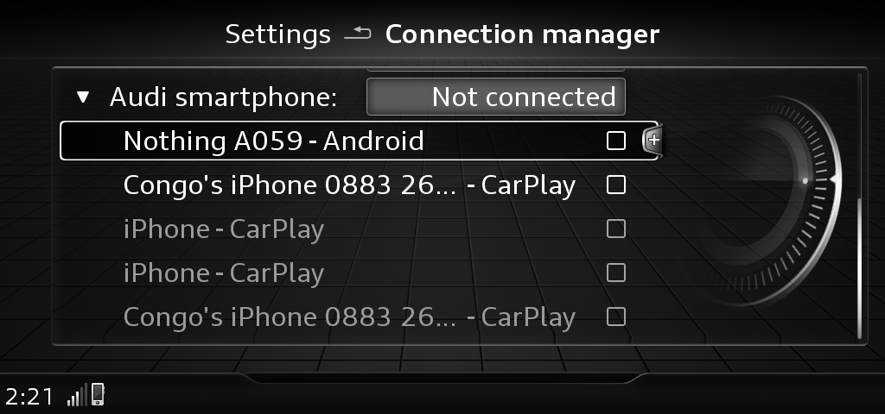
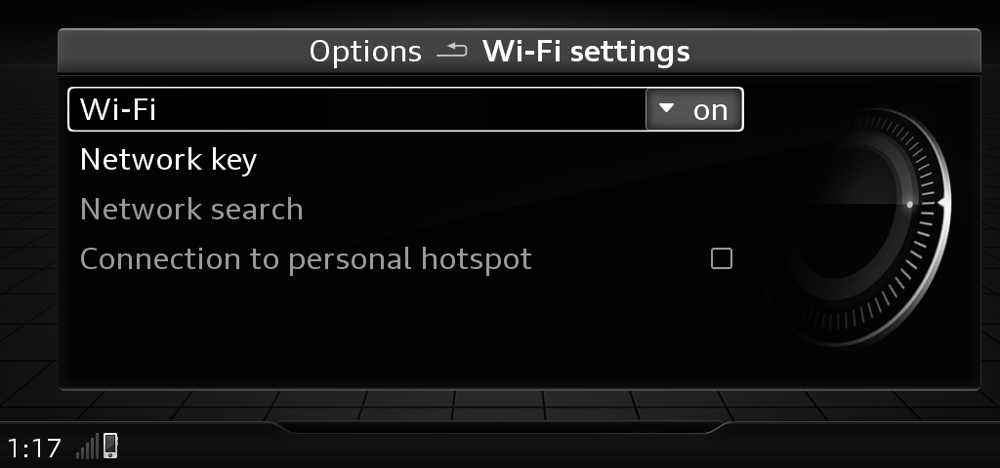

# CarPlay and Android Auto Wireless for Audi MHI2Q



Enable **wireless Apple CarPlay and Android Auto** on compatible Audi MHI2Q MMI units.

## Compatibility

| Component | Version |
|---|---|
| MMI Platform | Audi MHI2Q |
| MMI Software | 3638 |
| MU Version | 0917 |

**Current release:** MHI2Q 3638 / MU 0917

## Prerequisites

- The car's Wi-Fi must be **enabled** before installation.



## Installation

### 1. Prepare the SD Card

Copy the following files to the root directory of an SD card:

- `wcp.tar.gz`
- `AltScreen.sh`

### 2. Install

Insert the SD card into the MMI.

Open the MMI console and execute:

```bash
path_to_file/AltScreen.sh install
```

Replace `path_to_file` with the actual path to `AltScreen.sh` on your MMI.

### 3. Reboot

Once the installation is complete, reboot the MMI.

### 4. Pair Your Phone Again

After reboot:

1. Remove the existing phone pairing from the car.
2. Remove the car pairing from your phone.
3. Pair your phone with the MMI again.
4. When prompted, allow wireless CarPlay or Android Auto.
5. Enjoy wireless connectivity!

## Notes

- This release is currently intended for MHI2Q units running Software 3638 / MU 0917.
- Existing Bluetooth pairing must be removed and recreated after installation.
- Wireless connectivity requires the car's Wi-Fi to be enabled.

## License

See [LICENSE](docs/LICENSE) for license terms.

## Disclaimer

This modification is provided **as-is**, without warranty.

Installation and use are at your own risk. Always ensure you have a recovery method available before modifying your MMI software.
